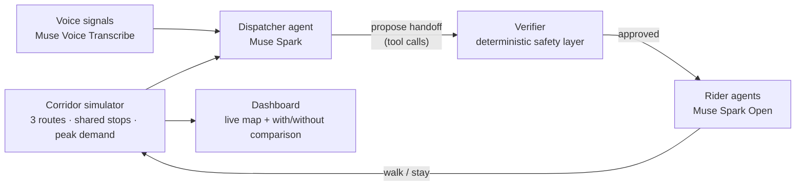

# BusDrop

**Your ticket belongs to your destination, not to one bus.**

BusDrop is an agentic dispatcher for crowded city bus corridors. When one bus is about to overflow, an AI agent finds another route's bus serving the same destination, brings the two buses to a shared stop, and moves riders across mid-route at no extra fare. The ticket still reads the same destination — only the bus underneath changes.

Built for the **Meta Global AI Developer Hackathon** (Track: Indie — *Build for Your World*).

## The problem

Three Chennai bus routes — from Royapettah, Teynampet, and Gemini — converge on Anna Salai and share a trunk into Broadway. During morning peak, one bus overflows while another on the same trunk runs with spare seats, and riders have no way to move between them. The result: crush-loaded buses, riders left behind at stops, and wasted capacity rolling down the same road.

## How it works



1. **Simulator** models the three routes, shared stops, bus capacity, and a morning-peak rider demand pattern. Every rider holds a destination.
2. **Dispatcher agent** (Muse Spark) reads live bus loads and ETAs, proposes handoffs via tool calls, and explains each decision in plain language.
3. **Verifier** is a deterministic safety layer that approves or rejects each proposal:
   - both buses serve the rider's destination,
   - both buses are within a short window of the shared stop,
   - the receiving bus has enough spare capacity.
4. **Rider agents** (Muse Spark Open) are simulated riders with a destination and a patience level who decide whether to walk across.
5. **Voice input** (Muse Voice Transcribe) turns Tamil/English driver and rider speech into crowd signals for the dispatcher.
6. **Dashboard** shows buses on a live map and compares runs with and without handoff: peak load, riders left behind, average wait.

> [!NOTE]
> The verifier is the safety backstop: the agent proposes, but only the verifier's rule checks can authorize a handoff. No proposal moves riders without passing all three checks.

## Meta models used

| Model | Role |
|---|---|
| Muse Spark | Dispatcher agent — reads corridor state, calls handoff tools, explains decisions |
| Muse Spark Open (via Baseten / Modal) | Rider agents — per-rider walk/stay decisions |
| Muse Voice Transcribe | Tamil/English speech-to-text for driver and rider crowd signals |

## What success looks like

Each simulated peak run reports with-handoff vs without-handoff on:

- **Peak load factor** — how full the fullest bus gets
- **Riders left behind** — boardings denied by capacity
- **Average wait** — stop waiting time across riders

The demo story: same fleet, same demand, fewer left-behind riders — because spare seats on the trunk get used.

## Project structure

```text
busdrop/
├── simulator/     # routes, stops, buses, demand model, run loop
├── dispatcher/    # Muse Spark agent, tool definitions, prompts
├── verifier/      # deterministic handoff approval checks
├── riders/        # Muse Spark Open rider agents
├── voice/         # Muse Voice Transcribe ingestion
└── dashboard/     # live map + comparison views
```

## Getting started

### Prerequisites

- Python 3.11+
- API access to Muse Spark, a Muse Spark Open endpoint (Baseten / Modal), and Muse Voice Transcribe

### Quickstart

```bash
git clone https://github.com/AathilFelix/busdrop.git
cd busdrop
pip install -r requirements.txt

# Run a peak-hour simulation without handoffs (baseline)
python -m simulator.run --no-handoff

# Run with the agentic dispatcher
python -m simulator.run --dispatcher spark

# Launch the dashboard
python -m dashboard.app
```

> [!TIP]
> Start with the `--no-handoff` baseline so you have numbers to beat before enabling the dispatcher.

## Roadmap

- [ ] Corridor simulator with peak demand pattern
- [ ] Dispatcher agent with handoff tool calls + explanations
- [ ] Deterministic verifier (destination, ETA window, capacity)
- [ ] Rider agents with patience-driven decisions
- [ ] Tamil/English voice crowd signals
- [ ] Dashboard with live map and run comparison
