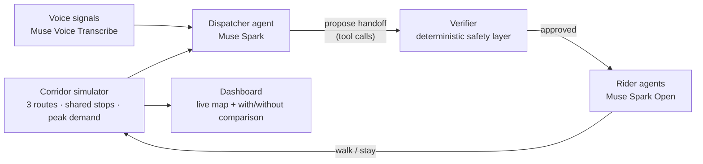

# BusDrop

> **Meta Global AI Developer Hackathon submission.** This repository was created during the event and holds
> only work done during it (Oct 26 – Nov 4, 2026), from the first corridor sketch to the Next.js
> frontend. Track: Indie — *Build for Your World*.


Your ticket belongs to your destination, not to one bus.

**BusDrop is an agentic dispatcher for crowded city bus corridors: when one bus is about to overflow, Meta's Muse Spark finds another route's bus serving the same destination and moves riders across mid-route at no extra fare — but only after a deterministic verifier approves the move.**

Every weekday morning, three Chennai bus routes — from Royapettah, Teynampet, and Gemini — converge on Anna Salai and share a trunk into Broadway. The Royapettah bus reaches LIC crush-loaded with riders still waiting on the platform, while a Teynampet bus dwelling at the same stop rolls on with spare seats. Today those riders are left behind. With BusDrop, the dispatcher spots the meet, the verifier checks both buses serve every rider's destination and the receiver has room, and the riders walk across — same ticket, same destination, only the bus underneath changes. **One simulated peak morning ends with 3 riders left behind instead of 20** ([the runs](#evidence-same-fleet-same-riders)).

## Built at the Meta hackathon

BusDrop is entered in the [Meta Global AI Developer Hackathon](https://cerebralvalley.ai/e/meta-ai-developer-hackathon/details)
(Oct 26 – Nov 4, 2026). Everything here was built during the event, in phases you can follow commit by commit:

- **The corridor:** a 3-route Anna Salai simulator with timed meets at shared trunk stops, a morning-peak demand pattern, and a ticket ledger where every rider holds a destination.
- **The safety story:** deterministic handoff mechanics plus a four-check verifier (destination, ETA window, capacity, ticket) — proven by a reckless proposer whose 22 unsafe moves get blocked.
- **Meta's models and agents:** the Muse Spark dispatcher proposing handoffs through `propose_handoff` tool calls, Muse Spark Open rider agents deciding walk/stay per rider, and Muse Voice Transcribe turning Tamil/English driver speech into crowd signals.
- **Two frontends on one engine:** a Next.js scenario-replay app and a Streamlit dashboard, both reading live runs from the same FastAPI engine, both comparing every morning against its no-handoff twin.

### Meta models used, and what BusDrop builds on them

| Meta model or agent | What BusDrop does with it | Where |
|---|---|---|
| **Muse Spark** (`muse-spark-1.3-contributor`) through Meta Model API | Reads corridor state at each shared-stop meet and answers with a `propose_handoff` tool call — receiver bus, rider ids, and a plain-language explanation a rider would understand | `dispatcher/spark.py`, `dispatcher/policy.py`, `dispatcher/tools.py` |
| **Muse Spark Open** (open weights, via the user's Baseten / Modal endpoint) | Per-rider walk/stay agents for every approved offer, with rule fallback on any error; the offline patience rule is the default | `riders/open.py`, `riders/policy.py` |
| **Muse Voice Transcribe** (`muse-voice-transcribe`) | Transcribes Tamil/English driver and rider audio to text; the parser turns it into crowd signals that raise the assumed waiting count at a stop for ~10 minutes | `voice/transcribe.py`, `voice/signals.py` |

What it adds on top: the corridor simulator with its timed meets, the ticket ledger that follows riders across buses, the verifier that every proposal must pass, the rider-consent layer, and the with/without comparison that keeps every claim honest. It is an agentic use case end to end: the agent reads live state, proposes through tools, explains itself — and the rules, not the agent, authorize the move.

> [!NOTE]
> The dispatcher runs on the contributor tier: identical model, lower price, and Meta may train on the traffic. Payloads are synthetic sim state (bus loads, stop ids), never personal data. All demand and rider data is synthetic — there is no real rider data anywhere in the product.

### Try it in three minutes

```sh
git clone https://github.com/AathilFelix/busdrop.git
cd busdrop
python3 -m venv .venv && source .venv/bin/activate
pip install -r requirements.txt

# Same morning, without and with BusDrop: denied boardings drop 20 → 3
python -m simulator.run --no-handoff
python -m simulator.run --handoff scripted --riders rule --voice demo
```

With a Meta Model API key (`export MODEL_API_KEY=...`, from [dev.meta.ai](https://dev.meta.ai)), the AI dispatcher drives instead of the scripted policy:

```sh
python -m simulator.run --dispatcher spark
```

No key? Everything above it runs offline — the scripted policy, the patience-rule riders, and the Tamil/English text fixtures never touch the network.

**Watch the morning unfold.** Start the engine and open the replay:

```sh
.venv/bin/uvicorn api:app --port 8000 &  # engine, from the repo root
cd web && npm install && npm run dev     # open http://localhost:3000
```

Pick a morning scenario, press Replay, and flip **With BusDrop / Without** to see the same fleet and riders end with fewer people left behind.

## How it works



- **The agent proposes, the rules dispose.** The dispatcher only ever *suggests* moves; the verifier approves or rejects each one on four deterministic checks, and a handoff is all-or-nothing — a rejected proposal leaves the simulation untouched.
- **Riders are agents too, not cargo.** Every approved move becomes an offer each rider can refuse. Impatient riders flee crush loads; seat-lovers stay put — in the demo morning, 4 of 21 riders decline.
- **The street talks back.** A driver note like *"LIC-la periya koottam, bus full-a poguthu"* parses into a crush signal that makes the dispatcher expect a bigger crowd at LIC for the next ten minutes.
- **Same fleet, same riders.** Every comparison runs the identical morning twice — the same buses, the same 509 riders — and only the dispatcher differs. If a number improves, the dispatcher earned it.

## The idea

Running more buses down a crowded corridor is expensive, and the spare capacity is often already there — on another route's bus, at the same stop, at the same minute. The missing piece is coordination: someone watching every meet, checking every destination, and moving the right riders before the doors close.

BusDrop is that coordinator. It treats the ticket as a promise to a destination rather than a seat on one bus, and spends the corridor's finite seats where the queue is longest:

- **From fixed assignments to fluid ones.** Riders board whichever bus comes first and flow across routes mid-journey when it helps — no extra fare, no re-ticketing, the ledger follows them.
- **From agent promises to checked moves.** An LLM proposes, but deterministic checks authorize: destination served, both buses at the stop, seats available, tickets valid.
- **From silent streets to signals.** What drivers already shout over the noise — *"bus full at LIC"* — becomes data the dispatcher acts on.

## Evidence: same fleet, same riders

One peak morning, seed 42, 180-minute window, 509 riders. Reproduce every line with the commands shown:

| Run | Left behind | Avg wait | Fullest bus | Moved |
|---|---:|---:|---:|---|
| Without BusDrop (`--no-handoff`) | 20 | 9.3 min | 100% | — |
| With BusDrop (`--handoff scripted --riders rule --voice demo`) | **3** | 9.3 min | 100% | 17 walked, 4 stayed |
| Reckless proposer (`--handoff reckless`) | 20 | 9.3 min | 100% | verifier: 62 approved, **22 rejected** |

The win is fewer left-behind riders from the same fleet: spare trunk seats get used instead of rolling past a queue. The fullest bus still touches 100% at some point in the peak — capacity is finite; BusDrop spends it where the queue is longest. And the reckless run proves the backstop: even a proposer that ignores capacity and destinations cannot overfill a bus or strand a rider, because the verifier rejects the unsafe moves.

## Get started

**Prerequisites:** Python 3.11+, Node 18+ for the web frontend. Copy `cp .env.example .env` and add `MODEL_API_KEY` only if you want the AI dispatcher.

**The simulator** (all offline except `--dispatcher spark`):

```sh
python -m simulator.run --no-handoff                              # baseline: numbers to beat
python -m simulator.run --handoff scripted                        # mechanical handoffs
python -m simulator.run --handoff reckless                        # verifier safety demo
python -m simulator.run --dispatcher spark                        # AI dispatcher (needs MODEL_API_KEY)
python -m simulator.run --handoff scripted --riders rule --voice demo   # full offline story
```

Useful flags: `--seed`, `--minutes`, `--demand-scale` (sensitivity tests), `--riders open` (LLM riders via `SPARK_OPEN_BASE_URL` + `SPARK_OPEN_API_KEY`), `--voice path/to/transcripts.json`.

**The web frontend** (scenario replay + with/without outcomes): engine on port 8000, then `cd web && npm install && npm run dev`. Three mornings (Morning rush, Festival crowd, Rainy Monday), two dispatchers (Standard moves, Muse Spark AI when the key is set). If Spark is unreachable the page falls back to Standard moves and says so.

**The Streamlit dashboard** (same engine, same numbers): `streamlit run dashboard/app.py`.

## How to read the code

```text
busdrop/
├── simulator/     # routes, stops, buses, demand model, run loop (run.py = CLI)
├── dispatcher/    # Muse Spark agent, propose_handoff tool schema, prompts
├── verifier/      # deterministic handoff approval checks
├── riders/        # rider agents (offline patience rule + Muse Spark Open client)
├── voice/         # crowd signals (parser + Muse Voice Transcribe client)
├── dashboard/     # Streamlit backup: live map, right-now rail, outcomes
├── api.py         # FastAPI engine serving runs to the web frontend
├── web/           # Next.js frontend: scenario replay + with/without outcomes
└── tests/         # 130 offline tests covering every module above
```

Verify a checkout with `.venv/bin/python -m pytest tests/` (130 tests, all offline) and `cd web && npm run lint && npm run build`.

> [!TIP]
> Start with the `--no-handoff` baseline so you have numbers to beat before enabling the dispatcher.

## What comes next

- A recorded demo of the replay UI for judges who can't run the stack.
- Real corridor timetables (GTFS) standing in for the hand-tuned demand pattern.
- More rider heterogeneity: group travel, accessibility needs, luggage.
